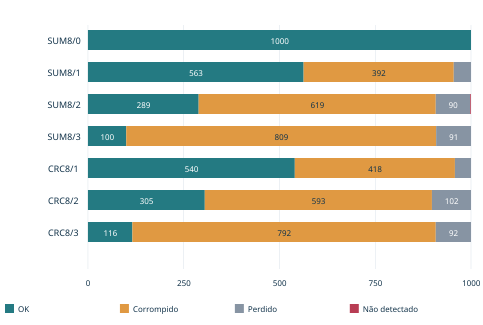
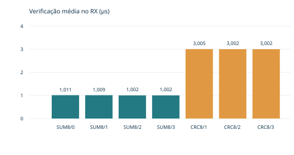

# Detecção de erros em telemetria sob ruído real

Enzo Aurélio · IFMT - Octayde · TCD - Transmissão e Comunicação de Dados

Professor Ruy Oliveira · Revisão CORPO64 · 19 de outubro de 2026

Repositório público: https://github.com/enzogomes2006/esp32-deteccao-erros-telemetria

## Resumo

Este trabalho compara SUM8 e CRC-8/SMBUS em um enlace UART com três ESP32: transmissor, receptor e injetor de ruído físico. Na revisão CORPO64, o sorteio alcança LEN, sequência, payload e CHK, cobrindo os 64 bits do corpo do quadro. Sete rodadas válidas de 1.000 quadros totalizaram 7.000 posições experimentais e 56.000 amostras do injetor. SUM8 apresentou dois erros não detectados no modo 2, com taxa de 2/621 = 0,3221% entre os erros checados dessa condição. CRC8 apresentou zero casos não detectados nas três rodadas ensaiadas. Os tempos médios de verificação no RX foram 1,006 µs e 3,003 µs, respectivamente. Em controle separado, o RX permaneceu sem recepção por 350,443 ms e voltou a aceitar um quadro 38,691 ms depois de reativar a UART. As conclusões se restringem ao modelo de perturbação ensaiado e distinguem checagem, entrega à aplicação e auditoria posterior.

Palavras-chave: ESP32; UART; checksum; CRC8; ruído físico; telemetria.

## 1. Objetivo e identificação da série

O objetivo é comparar duas técnicas de detecção no mesmo formato de quadro e observar falhas reais de comunicação. O payload contém quatro bytes sintéticos, não medições de um sensor. Cada condição usa uma técnica por vez. A série física atual foi coletada em 19/10/2026 após sete testes curtos de dez quadros. Dois controles adicionais de dez quadros registraram os tempos de cálculo do TX.

O relatório anterior, de 17/10/2026, usava ruído restrito ao payload e está preservado em historico/payload_2026-10-17/. Seus dados continuam em dados/ na raiz. Nenhuma contagem antiga foi somada à CORPO64. As tabelas deste relatório usam somente revisoes/corpo64/dados/.

## 2. Bancada e modelo de ruído

Três ESP32 clássicos WROOM exercem os papéis TX, RX e RUÍDO. A configuração documentada dos programas é ESP32 Dev Module, CPU de 240 MHz e Arduino-ESP32 3.3.12. A montagem usa GND comum, dois resistores de 1 kΩ e um BC547. TX usa GPIO17, RX usa GPIO16; o injetor observa a linha limpa em GPIO16, a perturbada em GPIO18 e comanda a base pelo resistor em GPIO19. O guia de montagem e os esquemas do repositório detalham as ligações.

O injetor força a linha ao nível baixo em instantes selecionados. Um alvo em bit já zero não muda o byte. O log separa máscara selecionada de máscara efetivamente alterada e registra os oito bytes antes/depois, sincronismo e atrasos. Os resultados dependem da captura e amostragem dessa bancada; a revisão lógica dos registros não substitui uma medição de forma de onda ou calibração elétrica independente.

| Modo | Seleção de alvos no corpo |
| --- | --- |
| 0 | Sem pulsos de ruído |
| 1 | Uma posição entre os 64 bits |
| 2 | Duas posições distintas entre os 64 bits |
| 3 | Rajada contígua de 3 a 8 bits em um dos oito bytes |
| 4 | Controle extra nos bits 7 de P0 e P1; fora das sete rodadas |

O marcador e a referência de depuração são preservados. Os ensaios não cobrem corrupção deliberada do marcador nem dos bits UART de start/stop. A rajada do modo 3 fica dentro de um byte, conforme o sorteio implementado.

## 3. Protocolo serial e detectores

O enlace é UART 115200 baud, 8N1, unidirecional, sem ACK nem retransmissão. O quadro tem doze bytes:

```text
A5 5A C3 3C | 07 seqL seqH p0 p1 p2 p3 CHK
```

| Campo | Bytes | Regra |
| --- | --- | --- |
| Marcador | 4 | A5 5A C3 3C; fora da checagem |
| LEN | 1 | 07; sete bytes posteriores a LEN |
| Sequência | 2 | uint16 little-endian |
| Payload | 4 | Telemetria sintética; bits 7 de P0/P1 fixados em 1 |
| CHK | 1 | SUM8 ou CRC8, conforme a rodada |

O RX reconhece o marcador, coleta oito bytes de corpo e exige LEN=7. Um LEN alterado não aumenta o limite de leitura. Se LEN for inválido, o quadro não chega à checagem e é classificado PERDIDO por enquadramento. O parser volta à busca de marcadores. Um marcador dentro do corpo é tratado como dado.

### 3.1. SUM8

O TX calcula CHK = -soma(LEN, seqL, seqH, p0, p1, p2, p3) módulo 256. O RX soma os oito bytes, incluindo CHK. Resíduo diferente de zero implica descarte. Alterações cuja diferença total seja múltipla de 256 mantêm o resíduo zero e podem produzir aceitação indevida.

### 3.2. CRC-8/SMBUS

O programa usa o polinômio x^8 + x^2 + x + 1, representação 0x07 sem o termo x^8, init=0, refin=false, refout=false e xorout=0. O TX calcula sobre sete bytes; o RX processa os oito e espera resíduo zero. O cálculo percorre cada byte MSB primeiro, enquanto a UART transmite seus bits LSB primeiro. O teste padrão da implementação é CRC8 de "123456789" = F4.

O CRC calcula um resto polinomial em GF(2), com XOR. O resultado experimental de zero falhas nesta série não deve ser convertido em garantia contra todo padrão de corrupção. LEN inválido é tratado pelo enquadramento antes da verificação de qualquer detector.

### 3.3. Decisão, enlace e referência

Após o quadro, o TX envia D5 6A B4 4B seguido de uma cópia dos oito bytes originais. A linha DECISAO_ANTES_DA_COPIA documenta a decisão antes da leitura da referência. A cópia serve para auditar e associar a posição experimental; não corrige o payload entregue nem o estado da sequência do enlace.

Corpos descartados não têm sequência confiável. O RX mantém eventos anônimos até conciliá-los com uma sequência aceita, sem transformar cada descarte em uma segunda perda. Sequências antigas ou repetidas não geram nova entrega. seq_rx conserva o que chegou, e seq_referencia/seq_experimento identificam a auditoria posterior. cabecalho_diverge registra divergências de LEN ou sequência, inclusive se um detector aceitar. ACEITO pelo detector e entregue_aplicacao são campos distintos.

Os timeouts são 60 ms para bloco/auditoria e 250 ms para ausência de progresso no enlace, com avanço de 100 ms por ausência adicional. Referências não renovam o prazo de enlace. Referência ausente, órfã, inválida ou associação ambígua invalida a medição; nenhum OK é inventado.

## 4. Método e conferência dos dados

Foram selecionadas quatro condições SUM8, modos 0 a 3, e três CRC8, modos 1 a 3, com mil quadros cada. O controle sem ruído CRC8 foi registrado entre os controles curtos, sem substituir nenhuma das sete condições. Cada pasta conserva rx.csv, ruido.csv, os dois logs brutos, metadados.json e revisao.txt. O manifesto fornece hashes SHA256. Os arquivos foram copiados byte a byte das pastas locais do coletor. Tentativas iniciais fora da série e controles curtos estão identificados em triagem/ e não entram nas tabelas principais.

O script scripts/consolidar.py recalcula contagens e resíduos, cruza os oito bytes com as amostras do injetor e verifica máscaras, efeito físico, sincronismo, atrasos, identidade das posições e a ordem de decisão/auditoria. Também compara os registros CSV com os logs brutos. A revisão original do coletor é executável separadamente. Nenhuma fixture sintética integra as medições físicas.

| Classe | Critério experimental |
| --- | --- |
| OK | Checagem aceitou e payload coincide com referência válida |
| CORROMPIDO | Checagem concluída; resíduo diferente de zero |
| PERDIDO | Sem checagem concluída: enquadramento ou ausência evidenciada |
| NAO_DETECTADO | Checagem aceitou, mas payload difere da referência válida |

Cada posição recebe uma única classe. A taxa de não detecção é ND/(CORROMPIDO+ND). OK e PERDIDO ficam fora desse denominador. Quando não há erro checado, a taxa é n.a., não zero por convenção. Um alvo já zero não constitui erro real. Contagens de condições diferentes não são amostras pareadas do mesmo ruído.

## 5. Resultados das sete rodadas

| Técnica | Modo | OK | Corrompido | Perdido | Não detectado |
| --- | --- | --- | --- | --- | --- |
| SUM8 | 0 | 1000 | 0 | 0 | 0 |
| SUM8 | 1 | 563 | 392 | 45 | 0 |
| SUM8 | 2 | 289 | 619 | 90 | 2 |
| SUM8 | 3 | 100 | 809 | 91 | 0 |
| CRC8 | 1 | 540 | 418 | 42 | 0 |
| CRC8 | 2 | 305 | 593 | 102 | 0 |
| CRC8 | 3 | 116 | 792 | 92 | 0 |

Cada linha soma 1.000 posições; cada rodada tem 8.000 amostras do injetor e rodada_valida=SIM. A conferência encontrou zero cabeçalhos divergentes em corpos aceitos nas sete rodadas. Divergências em corpos descartados ou malformados permanecem nos registros.



Figura 1. Classes registradas por condição, com mil quadros em cada barra. Os dois ND do SUM8/2 são identificados na tabela e no estudo de caso; sua largura é pequena nessa escala.

### 5.1. Taxas e perdas de enquadramento

| Condição | Erros checados | ND | Taxa ND | Perdidos por LEN |
| --- | --- | --- | --- | --- |
| SUM8/0 | 0 | 0 | n.a. | 0 |
| SUM8/1 | 392 | 0 | 0,0000% | 45 |
| SUM8/2 | 621 | 2 | 0,3221% | 90 |
| SUM8/3 | 809 | 0 | 0,0000% | 91 |
| CRC8/1 | 418 | 0 | 0,0000% | 42 |
| CRC8/2 | 593 | 0 | 0,0000% | 102 |
| CRC8/3 | 792 | 0 | 0,0000% | 92 |

Na rodada SUM8/2 ocorreram 621 erros checados, sendo 619 detectados e 2 não detectados. A taxa é 0,3221%. Em relação aos mil quadros transmitidos, os dois casos são 0,2%; esse é outro denominador e não substitui a taxa definida. Os 90 perdidos são excluídos da taxa de falha do detector.

Todas as perdas registradas nas sete condições tiveram motivo LEN_INVALIDO. Portanto, nesta série PERDIDO representa falha de enquadramento observada, e não comprova desaparecimento completo do quadro. A ampliação do ruído ao cabeçalho explica por que a CORPO64 contém perdas mesmo com os marcadores preservados. O ensaio de recepção desligada é apresentado separadamente.

### 5.2. Dois casos naturais não detectados

As sequências 415 e 553 da rodada SUM8/2 foram aceitas e entregues à aplicação com payload errado. Em ambos os casos, o log do injetor confirma alteração de 1 para 0 nos dois alvos, sincronismo SIM e ausência de flags de amostragem ou pulso tardio.

| Sequência | Campo | Transmitido | Recebido | Máscara real |
| --- | --- | --- | --- | --- |
| 415 | P0 | 87 | 07 | 80 |
| 415 | CHK | E7 | 67 | 80 |
| 553 | P3 | B3 | 33 | 80 |
| 553 | CHK | 89 | 09 | 80 |

Todos os valores de bytes e máscaras nessa tabela são hexadecimais. Os corpos completos são:

```text
seq 415 TX: 07 9F 01 87 BA 1E 13 E7
seq 415 RX: 07 9F 01 07 BA 1E 13 67
seq 553 TX: 07 29 02 EA CF D9 B3 89
seq 553 RX: 07 29 02 EA CF D9 33 09
```

Na sequência 415, a soma dos oito bytes transmitidos é 768, e a soma recebida é 512. Na sequência 553, as somas são 1.024 e 768. Apagar dois bits 7 reduz a soma em 128+128=256. Os dois valores de cada par continuam múltiplos de 256; o detector mantém resíduo zero. Em cada caso LEN e sequência permanecem intactos, enquanto payload e CHK mudam. A colisão foi observada em ruído aleatório do modo 2, sem usar o controle extra do modo 4.

O evento 416, correspondente à sequência 415, decide ACEITO em 709748318 µs e só depois registra referência em 709762509 µs. O evento 554, sequência 553, decide em 723686327 µs e recebe referência em 723700531 µs. Esses pares pertencem ao relógio do RX. Os timestamps absolutos do injetor não foram subtraídos dos timestamps do RX.

## 6. Tempos, taxa e overhead

### 6.1. Cálculo no transmissor

Controles separados de dez quadros, sem ruído, registraram 1 µs por cálculo SUM8 e 3 µs por cálculo CRC8. Em cada técnica, os nove intervalos após o primeiro quadro foram 101000 µs, ou 101 ms. O primeiro intervalo zero foi excluído. Os corpos fornecidos no chat foram cruzados com as referências das respectivas coletas curtas e coincidem. As transcrições estão em evidencias/corpo64/.

### 6.2. Verificação no receptor

| Condição | N checados | Média (µs) | Mediana (µs) | Mín. | Máx. |
| --- | --- | --- | --- | --- | --- |
| SUM8/0 | 1000 | 1,011 | 1,0 | 1 | 2 |
| SUM8/1 | 955 | 1,009 | 1,0 | 1 | 7 |
| SUM8/2 | 910 | 1,002 | 1,0 | 1 | 2 |
| SUM8/3 | 909 | 1,002 | 1,0 | 1 | 2 |
| CRC8/1 | 958 | 3,005 | 3,0 | 3 | 5 |
| CRC8/2 | 898 | 3,002 | 3,0 | 3 | 4 |
| CRC8/3 | 908 | 3,002 | 3,0 | 3 | 4 |

Os corpos com LEN inválido não chegaram à checagem e têm tempo NA. Foram excluídos das estatísticas de verificação, sem substituir ausência por zero. A média agregada SUM8 usa 3.774 checagens e vale 1,006 µs. CRC8 usa 2.764 checagens e vale 3,003 µs. Essas médias são ponderadas pelas amostras individuais, e não médias simples das linhas da tabela.



Figura 2. Média de verificação do RX nas sete condições. Unidade: microssegundos. Os tamanhos amostrais estão na tabela. A resolução registrada é de microssegundos; o log e o processamento da bancada podem afetar os extremos.

### 6.3. Intervalos e custo de transmissão

| Condição | N intervalos | Média (ms) | Mín. (ms) | Máx. (ms) |
| --- | --- | --- | --- | --- |
| SUM8/0 | 999 | 101,001 | 100,998 | 101,917 |
| SUM8/1 | 999 | 101,000 | 100,992 | 101,023 |
| SUM8/2 | 999 | 101,001 | 100,998 | 101,917 |
| SUM8/3 | 999 | 101,001 | 100,998 | 101,917 |
| CRC8/1 | 999 | 101,001 | 100,998 | 101,917 |
| CRC8/2 | 999 | 101,000 | 101,000 | 101,023 |
| CRC8/3 | 999 | 101,000 | 100,999 | 101,023 |

Os intervalos são medidos pelo RX entre inícios de quadros e usam 999 diferenças por rodada. A mediana é 101 ms em todas as condições. Não são tempos de recuperação nem incluem o primeiro zero.

Cada quadro de dados tem 4 bytes úteis e 8 de overhead: marcador 4, LEN 1, sequência 2 e CHK 1. A eficiência em bytes é 4/12=33,33%; overhead/total=66,67% e overhead/payload=200%. A cópia de depuração adiciona 12 bytes à instrumentação, totalizando 24 bytes e eficiência útil de 4/24=16,67% antes das pausas.

Em 8N1, cada byte ocupa dez bits na linha. Os 12 bytes de dados ocupam teoricamente 120/115200 s, cerca de 1,042 ms. Incluindo a cópia, o tempo teórico de serialização é cerca de 2,083 ms. Esses valores não incluem as pausas programadas de 10 ms após o marcador, 3 ms por byte do corpo e 10 ms antes da referência. O período observado de 101 ms resulta de todo o agendamento, não de uma mudança na taxa UART. Com quatro bytes úteis a cada 101 ms, a vazão útil aproximada é 39,60 bytes/s, ou 316,83 bit/s.

## 7. Recuperação após interrupção de recepção

O controle SUM8 de dez quadros usa ruído configurado em zero e desliga a UART do RX após auditar a sequência 1. É uma interrupção programada da recepção, sem alterar o firmware entre cálculo e recuperação. O log foi fornecido pelo usuário em dois trechos sobrepostos, unidos sem duplicar as linhas comuns; a procedência está em evidencias/corpo64/ORIGEM.md. Não há captura complementar do monitor do injetor para esse controle.

| Evento do RX | Instante (µs) |
| --- | --- |
| RX_DESLIGADO | 94561283 |
| Primeira detecção de ausência | 94797303 |
| RX_REATIVADO | 94911726 |
| Aceitação da sequência 5 | 94950417 |

A janela efetiva sem recepção foi 94911726-94561283=350443 µs, ou 350,443 ms. O tempo da reativação até a primeira aceitação foi 94950417-94911726=38691 µs, ou 38,691 ms. Desde a primeira detecção de perda até a aceitação foram 153114 µs, ou 153,114 ms. As medidas têm origens diferentes e não devem receber o mesmo rótulo.

O resumo registra 7 OK, 3 PERDIDOS (sequências 2, 3 e 4), zero CORROMPIDOS e zero ND. As sete auditorias somadas às três ausências evidenciadas contabilizam dez posições. O RX informa rodada_valida=SIM, zero ambiguidades e sequência esperada final 10. As perdas não são preenchidas com referências inventadas. Esse controle não entra nas sete condições de ruído.

## 8. Discussão e limites

Os dois casos SUM8 demonstram uma limitação concreta da soma modular: alterações no payload e no próprio detector podem preservar o resto. O CRC8 não apresentou ND nos modos ensaiados. As diferenças de OK entre técnicas também dependem dos sorteios e dos valores dos bytes; as rodadas não reutilizaram exatamente o mesmo ruído, portanto a diferença bruta de contagens não mede isoladamente uma vantagem do algoritmo.

A cópia posterior torna a auditoria possível, mas integra a instrumentação experimental. O resultado OK da tabela é definido pelo payload; divergências de cabeçalho precisam ser avaliadas nos campos específicos. A observação de zero cabeçalhos aceitos divergentes nesta série não elimina a possibilidade de colisões futuras no cabeçalho.

A ordenação uint16 e a passagem de 65535 para zero foram previstas/testadas em software, mas as rodadas físicas de 0 a 999 não exercitam esse cruzamento. As mensagens de versão foram observadas durante a gravação. Os metadados originais conservam firmware_instalado_verificado_pelo_programa=false e ajuste_isr_us_verificado_pelo_programa=false; não houve leitura de flash nem prova criptográfica do binário instalado. Os hashes publicados atestam integridade dos arquivos, não identidade do firmware em execução.

O registro de especificação prévia se refere somente à revisão CORPO64 e não comprova a ordem de elaboração do projeto original. Houve assistência de IA nos programas, na análise e na documentação. As regras da disciplina sobre autoria e defesa continuam aplicáveis. A demonstração presencial e a predição individual permanecem atividades a realizar, sem serem declaradas concluídas neste relatório.

## 9. Conclusão

A revisão CORPO64 produziu sete séries físicas consistentes e ampliou os alvos de ruído aos oito bytes do corpo. Dois payloads incorretos passaram pelo SUM8 no modo 2 e foram entregues, com evidência byte a byte e resíduo zero. O CRC8 registrou zero ND nas três condições ensaiadas. A verificação custou aproximadamente 1 µs no SUM8 e 3 µs no CRC8, muito abaixo do período de 101 ms adotado na bancada. O controle separado mostrou retomada após uma pausa de recepção, com distinção entre tempo sem UART, tempo após reativação e tempo desde a detecção de perda. Os dados, scripts e hashes permitem reproduzir a consolidação, dentro dos limites instrumentais descritos.

## Apêndice A. Rastreabilidade e reprodução

| Condição | Pasta original em revisoes/corpo64/dados/ |
| --- | --- |
| SUM8/0 | 20261019_091242_692_SUM8_modo0_1000 |
| SUM8/1 | 20261019_094547_976_SUM8_modo1_1000 |
| SUM8/2 | 20261019_095219_782_SUM8_modo2_1000 |
| SUM8/3 | 20261019_095929_835_SUM8_modo3_1000 |
| CRC8/1 | 20261019_100416_161_CRC8_modo1_1000 |
| CRC8/2 | 20261019_100921_806_CRC8_modo2_1000 |
| CRC8/3 | 20261019_101329_766_CRC8_modo3_1000 |

Cada pasta contém seis arquivos originais. PROVENIENCIA_COLETAS.json identifica a cópia e seus hashes. validacao/VALIDACAO_FISICA.json registra a conferência independente; validacao/REVISAO_OFICIAL_COLETAS.json registra a revisão pelo validador do coletor. Os logs de testes sintéticos e o estado prévio de compilação continuam preservados com sua data.

Para recalcular a partir dos dados versionados, instalar Python 3 e reportlab e executar, na raiz do repositório:

```text
python scripts/consolidar.py
python scripts/atualizar_documentacao.py
python scripts/gerar_pdf.py
python scripts/manifestos.py
```

## Fontes do trabalho

1. Implementações TX, RX e RUÍDO da revisão CORPO64: revisoes/corpo64/firmware/. O código é a fonte dos parâmetros do protocolo, sorteio, temporização e critérios de decisão.
2. Especificação registrada antes desta revisão: revisoes/corpo64/ESPECIFICACAO_REVISAO_PRE_IMPLEMENTACAO.md. Documento histórico, não atualização retrospectiva da proposta.
3. Sete coletas físicas de 19/10/2026: revisoes/corpo64/dados/, identificadas no Apêndice A.
4. Controles de cálculo e recuperação transcritos do chat: evidencias/corpo64/, com procedência em ORIGEM.md.
5. Documentação e medições anteriores: historico/payload_2026-10-17/, dados/, evidencias/ e pdfs_por_etapa/. Servem à rastreabilidade histórica e não às contagens atuais.
