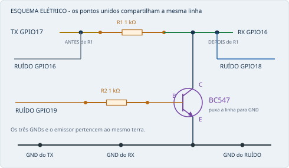
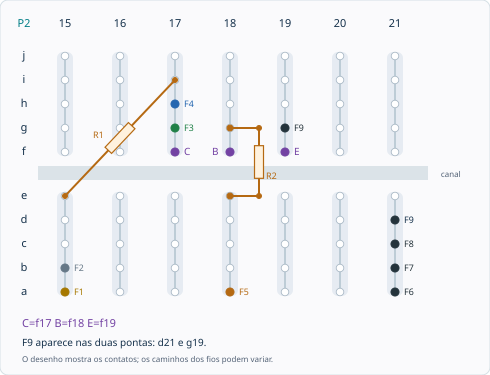

# Guia da montagem física do seu ESP32

Este guia descreve a fiação indicada para sua montagem, compatível com o TX atual, RX CORPO64 v1.0 e RUÍDO CORPO64 v2.0. Não exige remontar o circuito. Se for mexer nos contatos, desligue os três USBs.

## 1. Oriente o conjunto

Na horizontal, deixe o número 1 à esquerda e 63 à direita. P1 é a protoboard de cima; P2 é a de baixo. Todos os furos citados abaixo ficam na P2.

De cima para baixo em cada protoboard: j, i, h, g, f - canal - e, d, c, b, a. Furos a-e do mesmo número são ligados entre si. Furos f-j daquele mesmo número formam outro grupo, separado pelo canal. Números diferentes não são ligados entre si.

## 2. Esquema elétrico

O RUÍDO é uma única placa representada em três pontos. Seu GPIO16 lê a linha limpa, GPIO18 observa a linha perturbada e GPIO19 aciona a base através de R2.

## 3. Nove jumpers

As cores são apenas uma legenda sugerida. Se seus fios são de outras cores, siga a origem e o destino.

| Fio | Origem | Destino na P2 | Cor sugerida | Função |
|---|---|---|---|---|
| F1 | TX - GPIO17 / TX2 | **a15** | Amarelo | Leva os dados do TX até a linha limpa. |
| F2 | RUÍDO - GPIO16 / RX2 | **b15** | Branco | Lê os dados originais, antes de R1. |
| F3 | RX - GPIO16 / RX2 | **g17** | Verde | Recebe os dados depois de R1. |
| F4 | RUÍDO - GPIO18 | **h17** | Azul | Observa a linha perturbada, depois de R1. |
| F5 | RUÍDO - GPIO19 | **a18** | Laranja | Aciona a base do BC547 através de R2. |
| F6 | TX - GND | **a21** | Preto | Liga o terra do TX ao grupo comum. |
| F7 | RX - GND | **b21** | Preto | Liga o terra do RX ao grupo comum. |
| F8 | RUÍDO - GND | **c21** | Preto | Liga o terra do RUÍDO ao grupo comum. |
| F9 | P2 - d21 | **g19** | Preto | Jumper entre o grupo GND e o emissor. |

"Do GPIO" significa sair do próprio pino ou de um furo livre conectado a esse pino no mesmo grupo da protoboard. Siga o número GPIO impresso na placa; as posições dos pinos variam entre modelos. Não confunda TX2/RX2 com TX0/RX0.

## 4. Dois resistores e BC547

| Componente | Primeira ponta P2 | Segunda ponta P2 | Função |
|---|---|---|---|
| R1 - linha, 1 kΩ | e15 | i17 | Fica entre o TX e o RX. |
| R2 - base, 1 kΩ | e18 | g18 | Fica entre GPIO19 e a base. |

Os dois resistores são de **1 kΩ (1000 Ω)** e não têm polaridade.

| Perna do BC547 | Furo P2 |
|---|---|
| Coletor C | f17 |
| Base B | f18 |
| Emissor E | f19 |

Para o BC547 TO-92 de pinagem usual, com a face plana para você e as pernas para baixo, a sequência é C-B-E da esquerda para a direita. A pinagem do fabricante da peça prevalece. A [folha de dados onsemi](https://www.onsemi.com/pdf/datasheet/bc546-d.pdf) identifica 1=coletor, 2=base, 3=emissor.

## 5. Recorte da protoboard P2

F1 a F8 indicam pontas dos fios vindos das placas. F9 é o jumper curto, marcado nas duas pontas, d21 e g19. C, B e E identificam os furos das pernas, não a posição do corpo de uma placa ESP32.

| Grupo P2 | Contatos que compartilham o grupo |
|---|---|
| a15-e15 | F1 + F2 + ponta de R1: linha limpa |
| f17-j17 | C + F3 + F4 + outra ponta de R1: linha perturbada |
| a18-e18 | F5 + ponta de R2: comando do transistor |
| f18-j18 | B + outra ponta de R2: base |
| f19-j19 | E + ponta F9: emissor ligado ao GND |
| a21-e21 | F6 + F7 + F8 + outra ponta F9: terra comum |

## 6. Conferência das ligações

- Linha limpa: TX GPIO17 e RUÍDO GPIO16 chegam no grupo a15-e15, antes de R1.
- Linha perturbada: RX GPIO16, RUÍDO GPIO18 e o coletor chegam no grupo f17-j17, depois de R1.
- Comando da base: RUÍDO GPIO19 chega em a18; R2 liga e18 a g18; a base fica em f18.
- Terra: os três GNDs se unem em a21/b21/c21; F9 liga d21 a g19; o emissor fica em f19.
- C, B e E ficam nos três números 17, 18 e 19. Não coloque as três pernas no mesmo grupo f17/g17/h17.
- Cada placa é alimentada pelo próprio USB. Não interligue 3V3 nem VIN/5V das placas.
- GPIO17 do RX, GPIO16 do TX e GPIO17 do RUÍDO ficam sem fio externo. Não há retorno RX para TX.
- Nenhum trilho vermelho/azul é usado como contato deste mapa.

## 7. O que cada componente faz

R1 fica no caminho TX-RX e limita a corrente quando o transistor puxa a linha para baixo. R2 limita a corrente que GPIO19 fornece à base. O BC547 conduz entre coletor e emissor quando acionado e pode apagar bits que estavam em 1. O emissor e os três ESP32 compartilham GND.

O guia descreve as ligações indicadas para a bancada; não mede continuidade elétrica nem comprova, sozinho, o estado atual de cada contato. As imagens ilustrativas antigas não são usadas como referência de posição dos GPIOs neste documento.
